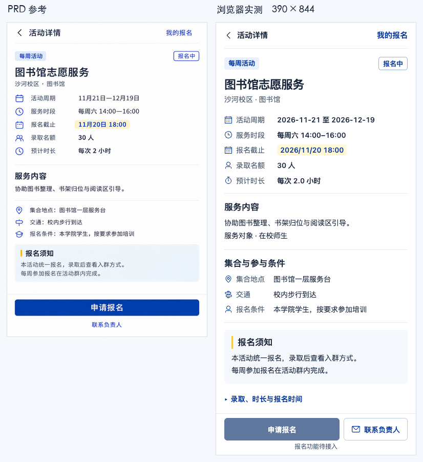
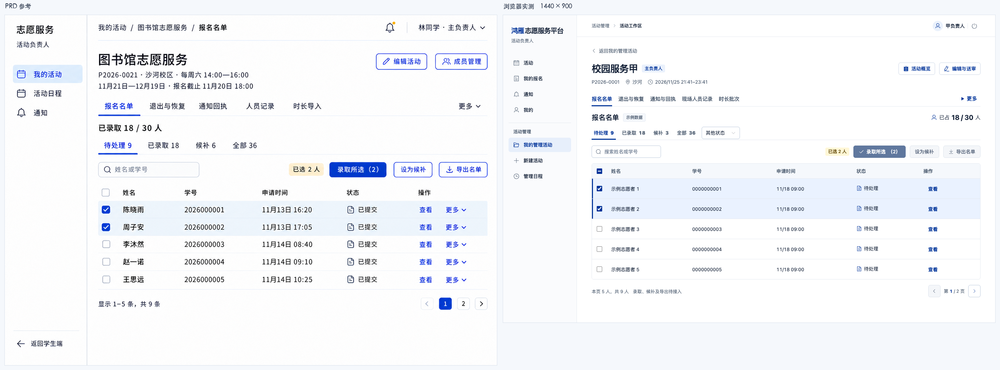

# 三端界面对照

下列五张对照图左侧为 PRD v1.3.4 第 21 章参考，右侧为留存的 Chromium 系浏览器截图。两侧按等宽排版。桌面视口为 1440 × 900，手机为 390 × 844。复验时使用独立测试库中的合成账号和活动。

## 学生活动详情

从公开列表进入已获批的每周活动。在手机首屏核对截止时间、每次预计时长和两行报名须知。开放期内可填写选填说明并申请，成功后按钮显示「已提交，待审核」。



## 负责人报名名单

从「我的管理活动」进入活动的「报名名单」，手机从底栏「管理」进入。核对待处理 9 人、本页 5 人、已选 2 人、整项已占 18/30。翻页保留勾选，切换筛选清空选择。「查看」内可单人录取，表格上方的批量录取、候补和导出按钮仍禁用。



## 后台时长批次审核

源文件、提交人和送审时间在明细表上方。原表第 4 行的选中状态对应下方核实区，结论和意见跨筛选与分页保留。当前样例有两行需要核实，全批 5 条、合计 10.0 小时。整批通过按钮提供预览。


## 负责人时长导入

用合成时长表复验。错误报告应定位到原表第 202 行，勾选「只看违纪待核实行」应显示第 804 行。筛选或翻页后，全批预计差额仍为 +9.0 小时。运行 `pnpm test:pages` 前将 `HOUR_EVIDENCE_DIR` 设为本地输出目录的绝对路径，可保存合成工作簿、错误报告及桌面和手机截图。[合成样本与验收记录](https://github.com/BUPT-Hongyan-Volunteer-Association/Hongyan-Volunteering-Platform/pull/7)

## 桌面日程

学生端周视图固定名称列。点选 11 月 21 日下午的色条，右侧显示该时段详情。竖线标记示例评估时刻 11 月 18 日 10:00。列表与时间轴共用日期窗口和筛选。


## 手机日程

手机默认列表。切到日程后可横滚时间轴，点选名称或时间条进入详情，返回后保留所选时段并显示摘要。截图显示 11 月 21 日上午的选择，窗口外的当前时间线隐藏。「今天」沿用当前时间刻度。时段取自示例，进入获批详情或待审核页面时另行核验权限。


## 活动发现

桌面日历和手机筛选均按北京时间服务日期查询真实公开列表。搜索、校区、报名阶段、活动状态及服务日期在进入详情后可以恢复。截图中两项活动均为测试库中的获批版本。

[桌面活动发现](discovery.png) · [手机活动发现](discovery-phone.png)

## 复验

从本地身份选择页分别打开学生、负责人和审核员窗口。拖动窗口边缘，再进入全屏并还原，核对页面宽高随浏览器可视区域变化。另在 1920 × 1080 视口检查活动详情、管理活动列表和后台待办。正文应从侧栏右侧延伸到窗口右边缘，只保留设计内边距，收起后台侧栏后正文应随之变宽。长表可在表内横滚，页面整体无横向滚动条。

按[工程说明](../../README.md)配置开发环境。日常走查运行 `pnpm test:pages`。更新图片时，在工程根目录设置绝对路径 `UI_CAPTURE_DIR`，让同一套回归额外保存截图。

macOS 示例

```sh
mkdir -p .local/ui-verification
UI_CAPTURE_DIR="$PWD/.local/ui-verification" pnpm test:pages
```

Windows PowerShell 示例

```powershell
New-Item -ItemType Directory -Force .local/ui-verification | Out-Null
$env:UI_CAPTURE_DIR = (Resolve-Path .local/ui-verification).Path
try { pnpm.cmd test:pages } finally { Remove-Item Env:UI_CAPTURE_DIR }
```

截图目录中的 `student.png`、`roster.png`、`hours.png`、`schedule-week.png`、`schedule-hour.png` 依次对应 21-1 至 21-5。先核对业务状态，再与原参考图等宽并排更新正式图片。活动发现的两张截图可直接按同名文件核对。

[三端界面规范](../../DESIGN.md) · [页面回归](../../apps/api/test/pages.test.mjs)
