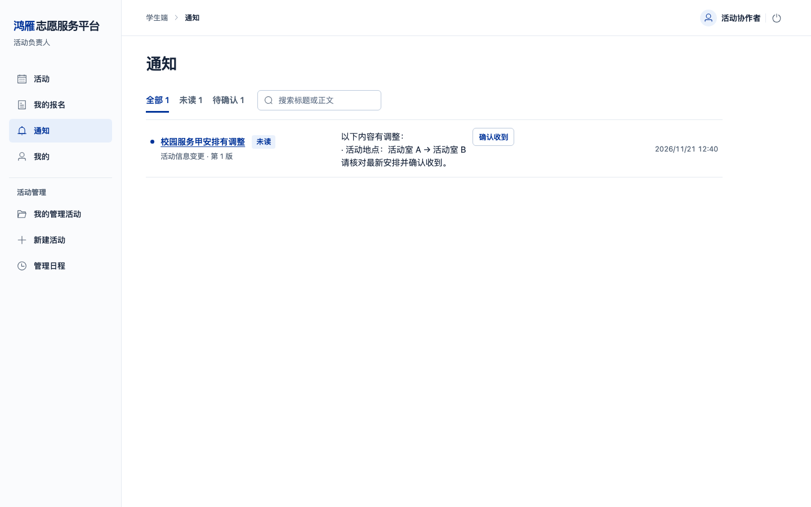

# 三端记录页面示例

三张图均来自独立测试库的合成账号，截图尺寸为 1440 × 900。对应的布局和共享组件见[三端界面规范](../../DESIGN.md#桌面布局与共享记录组件)。

## 学生通知

「校园服务甲」的地点修订获批后，已录取学生从「通知」查看新旧地点、版本和发布时间。打开详情标记已读，点击「确认收到」写入回执，负责人可在「通知与回执」核对确认时间和待跟进名单。[学生收件箱](../../apps/web/src/notices/MyNotices.vue) · [负责人回执](../../apps/web/src/notices/ActivityNotices.vue)

## 现场人员记录

负责人进入「我的管理活动 → 校园服务甲 → 现场人员记录」，按服务日期批量登记异常，之后可在原记录更正或撤销。截图中每行对应一名学生在该日期的异常。[现场人员记录](../../apps/web/src/attendance/AttendanceRecords.vue)

## 审核申诉

审核员从「申诉与更正」选中漏记反馈，核对已批准的修复结果并结案。左栏保留反馈队列，右栏显示学生说明和处理结果。窄屏从详情返回队列。[申诉组件](../../packages/ui/src/HourAppeals.vue) · [四账号时长回归](../../apps/api/test/hour-ledger-pages.mjs)

## 更新截图

按[本地运行说明](../../README.md#本地运行)准备环境。将 `UI_CAPTURE_DIR` 设为已有目录的绝对路径，运行 `pnpm test:pages`。核对页面、状态和尺寸后，按本页三个原文件名替换。时长流程可另设 `HOUR_EVIDENCE_DIR` 导出合成工作簿、错误报告和截图。[页面回归入口](../../apps/api/test/pages.test.mjs)
