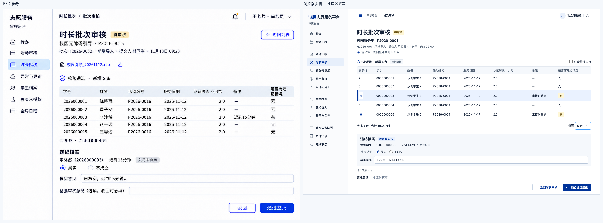

# 三端界面对照

下列五张对照图左侧为 PRD v1.3.4 第 21 章参考，右侧为留存的 Chromium 系浏览器截图。两侧按等宽排版。桌面视口为 1440 × 900，手机为 390 × 844。复验时使用独立测试库中的合成账号和活动。

## 学生活动详情

从公开列表进入已获批的每周活动。在手机首屏核对截止时间、每次预计时长和两行报名须知。开放期内可填写选填说明并申请，成功后按钮显示「已提交，待审核」。


## 负责人报名名单

从「我的管理活动」进入活动的「报名名单」，手机从底栏「管理」进入。核对待处理 9 人、本页 5 人、已选 2 人、整项已占 18/30。翻页保留勾选，切换筛选清空选择。「查看」内可单人录取，表格上方的批量录取、候补和导出按钮仍禁用。


## 后台时长批次审核

源文件、提交人和送审时间在明细表上方。原表第 4 行的选中状态对应下方核实区，结论和意见跨筛选与分页保留。当前样例有两行需要核实，全批 5 条、合计 10.0 小时。整批通过按钮提供预览。



## 负责人时长导入 · Issue #5

负责人在“我的管理活动 → 选择活动 → 时长批次”上传工作簿。此处为独立 PostgreSQL 库中的合成活动 `P2026-0901`，选用历史获批安排版本 1。测试预置了一笔其他活动的同日时长 18.0 小时。

| 核对位置 | 预览所见 |
| --- | --- |
| 原表第 2、3 行 | 第 2 行新增 2.0 小时，第 3 行相同，跳过。 |
| 原表第 202 行 | 点击顶部“查看 1 行错误”即可定位。原值 1.25 超出一位小数，下载的错误报告也列出该行的认证时长字段。 |
| 原表第 804 行 | 本次 7.0 小时加上已有的 18.0 小时，当日预计 25.0 小时。时长警告与违纪待核实分列。 |
| 筛选与翻页 | 21 行中有效 2 行、跳过 18 行、错误 1 行。全批预计差额始终为 +9.0 小时。 |
| 修正后重新上传 | 第 202 行改为 1.2，省去末尾 17 条重复数据。4 行中有效 3 行，跳过 1 行，预计差额 +10.2 小时。 |

[原工作簿](issue-5/合成时长表.xlsx) · [错误报告](issue-5/错误报告.xlsx) · [修正工作簿](issue-5/修正时长表.xlsx) · [桌面错误行](issue-5/桌面-错误原行.png) · [手机时长警告](issue-5/手机-违纪与时长警告.png)

在有建库权限的本地 PostgreSQL 环境运行 `pnpm --filter @hongyan/api test:flow` 和 `pnpm test:pages` 可重建上述活动并复验。回归还覆盖旧六列的 5,000 条上限、超限报告行号、权限回收、响应丢失后再次上传、原批次重试，以及正式时长记录逐条一致。

### 三项修复的手动复验

在合成活动 `P2026-0901` 的「时长批次」页选择「新增时长」和获批安排「版本 1」，逐份上传。每次可点「返回时长批次」开始下一份。四份工作簿均含刻意设置的错误，预期状态均为「内容有误」。

| 工作簿 | 上传后核对 |
| --- | --- |
| [01 错姓名在前](issue-5/修复复验/01-错姓名在前.xlsx) | 第 2 行姓名与档案不符，第 202 行有效。有效 1、跳过 0、错误 1，预计 +4.0 小时。 |
| [02 错姓名在后](issue-5/修复复验/02-错姓名在后.xlsx) | 第 2 行有效，第 202 行姓名与档案不符。与 01 相比只有姓名对调，全批计数和预计时长相同。 |
| [03 时长冲突与违纪待核实](issue-5/修复复验/03-时长冲突与违纪待核实.xlsx) | 同一学生、活动、服务日期分别填入 4 和 5 小时，第 2、804 行均报冲突。勾选「只看违纪待核实行」后仅显示第 804 行，全批预计差额仍为 0.0 小时。 |
| [04 两处未知列](issue-5/修复复验/04-两处未知列.xlsx) | 点「下载错误报告」。同一份报告应列出原表第 202 行的 H202 和第 804 行的 H804，原因均为「未知列存在数据」。 |

## 桌面日程

学生端周视图固定名称列。点选 11 月 21 日下午的色条，右侧显示该时段详情。竖线标记示例评估时刻 11 月 18 日 10:00。列表与时间轴共用日期窗口和筛选。


## 手机日程

手机默认列表。切到日程后可横滚时间轴，点选名称或时间条进入详情，返回后保留所选时段并显示摘要。截图显示 11 月 21 日上午的选择，窗口外的当前时间线隐藏。「今天」沿用当前时间刻度。时段取自示例，进入获批详情或待审核页面时另行核验权限。


## 活动发现

桌面日历和手机筛选均按北京时间服务日期查询真实公开列表。搜索、校区、报名阶段、活动状态及服务日期在进入详情后可以恢复。截图中两项活动均为测试库中的获批版本。

[桌面活动发现](discovery.png) · [手机活动发现](discovery-phone.png)

## 复验

按[工程说明](../../README.md)配置开发环境。日常走查运行 `pnpm test:pages`。更新图片时，在工程根目录设置绝对路径 `UI_CAPTURE_DIR`，让同一套回归额外保存截图。

macOS 示例

```sh
mkdir -p .local/ui-verification
UI_CAPTURE_DIR="$PWD/.local/ui-verification" pnpm test:pages
```

Windows PowerShell 示例

```powershell
New-Item -ItemType Directory -Force .local/ui-verification | Out-Null
$env:UI_CAPTURE_DIR = (Resolve-Path .local/ui-verification).Path
try { pnpm.cmd test:pages } finally { Remove-Item Env:UI_CAPTURE_DIR }
```

截图目录中的 `student.png`、`roster.png`、`hours.png`、`schedule-week.png`、`schedule-hour.png` 依次对应 21-1 至 21-5。先核对业务状态，再与原参考图等宽并排更新正式图片。活动发现的两张截图可直接按同名文件核对。

[三端界面规范](../../DESIGN.md) · [页面回归](../../apps/api/test/pages.test.mjs)
