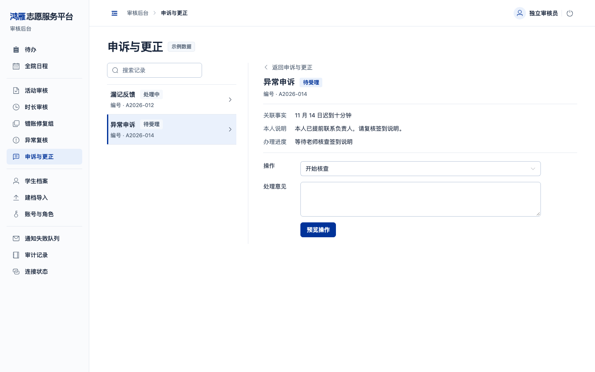

# 三端记录页面示例

以下均为 1440 × 900 下的页面回归截图。数据来自独立测试库与标记的示例记录。版式选择和其他页面的适用范围见[三端界面规范](../../DESIGN.md#桌面布局与共享记录组件)。

## 学生通知

以学生身份从「通知」进入。全部三条记录直接显示标题、活动、状态、正文和日期。选择「未读」只显示一条，输入不匹配的搜索词后出现空态。集合地点调整的回执在当行预览。[组件与实现](../../apps/web/src/personal/NoticeInbox.vue)

## 现场人员记录

以负责人身份从「我的管理活动」进入「校园服务甲」，选择「现场人员记录」。两名同学的到场或请假情况、服务日期和说明在同一行。按 2026-11-15 筛选后仅余许同学，手机可直接阅读同一组字段。[组件与实现](../../apps/web/src/activities/OrganizerSection.vue)

## 审核申诉

以审核员身份进入「申诉与更正」，选择 A2026-014。左栏保留该队列，右栏显示关联事实、本人说明、办理进度与预览操作。切换到 A2026-012 时表单属于新对象。窄屏显示所选详情，可返回队列。[组件与实现](../../apps/admin/src/management/ManagementPage.vue)

## 更新截图

按[工程说明](../../README.md)准备环境，运行 `pnpm test:pages`。需要重新生成图片时，将 `UI_CAPTURE_DIR` 设为一个已创建目录的绝对路径，再运行同一命令。核对三张图的页面、状态与尺寸后，按原文件名替换。另用 390px 验证手机导航、1024px 验证分栏切换、1920px 验证阅读宽度和后台侧栏收起后的布局。

时长导入的独立业务验收仍支持通过 `HOUR_EVIDENCE_DIR` 导出合成工作簿、逐行错误报告和测试截图。[页面回归](../../apps/api/test/pages.test.mjs)
