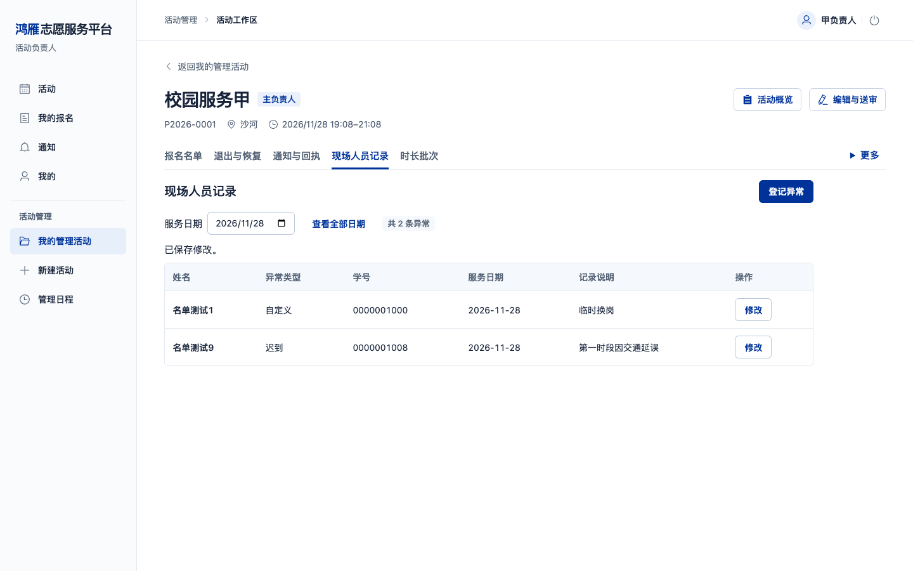

# 三端记录页面示例

以下均为 1440 × 900 下的页面回归截图。数据来自独立测试库与标记的示例记录。版式选择和其他页面的适用范围见[三端界面规范](../../DESIGN.md#桌面布局与共享记录组件)。

## 学生通知

在独立测试库中修改「校园服务甲」的地点，经审核批准后，用已录取的合成账号从「通知」进入。列表直接显示变更前后的地点、版本、阅读状态和发布时间。可搜索标题或正文，筛选全部、未读、待确认。打开详情会标记已读，点击列表或详情中的「确认收到」写入真实回执。[学生通知](../../apps/web/src/notices/MyNotices.vue)

负责人从该活动的「通知与回执」选择通知，桌面并排查看通知队列与接收人，窄屏可从回执返回列表。切换到「全部接收人」可见已读状态，确认后刷新可见确认时间，该学生同时移出「待跟进」。已被替代的通知保留历史回执。后台失败队列页面仍为示例，事件查询与重试的 API 由 `test:notice` 验证。[负责人回执](../../apps/web/src/notices/ActivityNotices.vue)

## 现场人员记录

以负责人身份从「我的管理活动」进入「校园服务甲」，选择「现场人员记录」。点击「登记异常」，选择服务日期、异常类型和报名人员后批量保存。列表每行对应一名学生在该日期的异常，显示类型和说明。手机可直接阅读同一组字段。[组件与实现](../../apps/web/src/attendance/AttendanceRecords.vue)

## 审核申诉

以审核员身份进入「申诉与更正」，选择 A2026-014。左栏保留该队列，右栏显示关联事实、本人说明、办理进度与预览操作。切换到 A2026-012 时表单属于新对象。窄屏显示所选详情，可返回队列。[组件与实现](../../apps/admin/src/management/ManagementPage.vue)

## 更新截图

按[工程说明](../../README.md)准备环境，运行 `pnpm test:pages`。需要重新生成图片时，将 `UI_CAPTURE_DIR` 设为一个已创建目录的绝对路径，再运行同一命令。核对三张图的页面、状态与尺寸后，按原文件名替换。另用 390px 验证手机导航、1024px 验证分栏切换、1920px 验证阅读宽度和后台侧栏收起后的布局。

时长导入的独立业务验收仍支持通过 `HOUR_EVIDENCE_DIR` 导出合成工作簿、逐行错误报告和测试截图。[页面回归](../../apps/api/test/pages.test.mjs)
