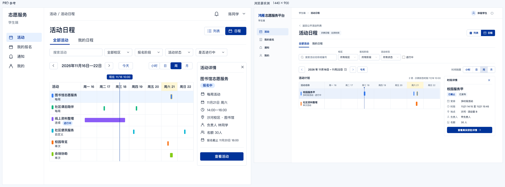
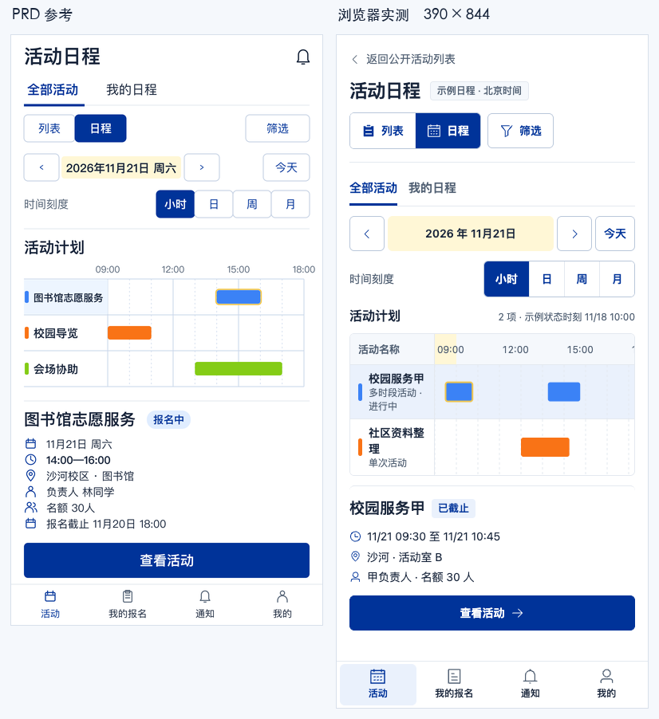

# 三端界面对照

左侧为 PRD v1.3.4 第 21 章原图，右侧为当前前端生产构建在 Chrome 中的截图。每组两侧按相同宽度排版。桌面视口为 1440 × 900，手机为 390 × 844。截图使用独立测试库中的合成账号和活动。

## 学生活动详情

从公开列表进入已获批的每周活动。报名截止、每次预计时长、参与条件和两行报名须知都在手机首屏。展开下方说明可查看录取规则、时长认定和报名时间。「联系负责人」显示该活动配置的联系方式。正式报名写入待接入，主按钮显示禁用原因。


## 负责人报名名单

负责人可从左侧“活动管理”分组进入名单所在活动，手机使用底栏“管理”。工作区显示活动名称、编号、时段和当前成员身份。待处理 9 人、本页 5 人、已选 2 人，已占名额为 18/30。示例名单含候补 3 人，参考图为 6 人。翻页保留勾选及行底色，切换筛选清空选择。录取、候补和导出暂为禁用操作。


## 后台时长批次审核

源文件、提交人和送审时间在明细表上方。原表第 4 行的选中状态对应下方核实区，结论和意见跨筛选与分页保留。当前样例有两行需要核实，全批 5 条、合计 10.0 小时。整批通过按钮提供预览。


## 桌面日程

图中为学生端周视图，活动名称列固定。选中的 11 月 21 日下午时段在右侧显示详情，时间线标记样例的 11 月 18 日 10:00。图中的活动及分段来自现有示例日程，名称、条数和颜色随测试数据而异。列表和日程共用范围、时间刻度、日期与筛选。点击色条直接打开对应时段，日期箭头按当前时间刻度翻页。



## 手机日程

手机默认列表。切到日程后可横滚时间轴，点选名称或时间条进入详情，返回后保留所选时段并显示摘要。截图显示 11 月 21 日上午的选择，窗口外的当前时间线隐藏。「今天」沿用当前时间刻度。日程仍使用有标识的示例时段，获批详情和待审版本另经授权接口读取。



## 活动发现

桌面日历和手机筛选均按北京时间服务日期查询真实公开列表。搜索、校区、报名阶段、活动状态及服务日期在进入详情后可以恢复。截图中两项活动均为测试库中的获批版本。

[桌面活动发现](discovery.png) · [手机活动发现](discovery-phone.png)

## 复验

在已完成本机配置的工程根目录运行以下命令。日常回归直接运行 `pnpm test:pages`。需要更新对照图时，按下方命令另存原始截图，核对页面状态后再更新对应的正式图片。页面回归使用独立数据库，覆盖三端导航、名单跨页选择、时长逐行核实、日期筛选、四种时间刻度以及从审核和详情返回日程。

```sh
source .local/env.sh
pnpm typecheck
mkdir -p .local/ui-verification
UI_CAPTURE_DIR="$PWD/.local/ui-verification" pnpm test:pages
pnpm --filter @hongyan/api test:flow
```

[三端界面规范](../../DESIGN.md) · [页面回归](../../apps/api/test/pages.test.mjs)
